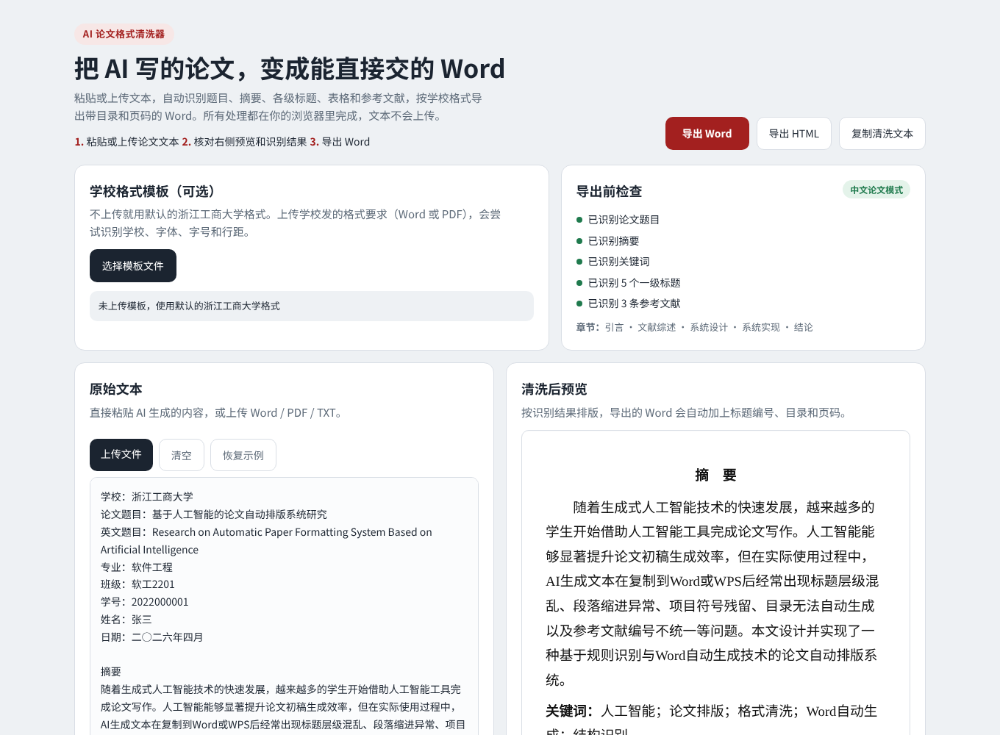
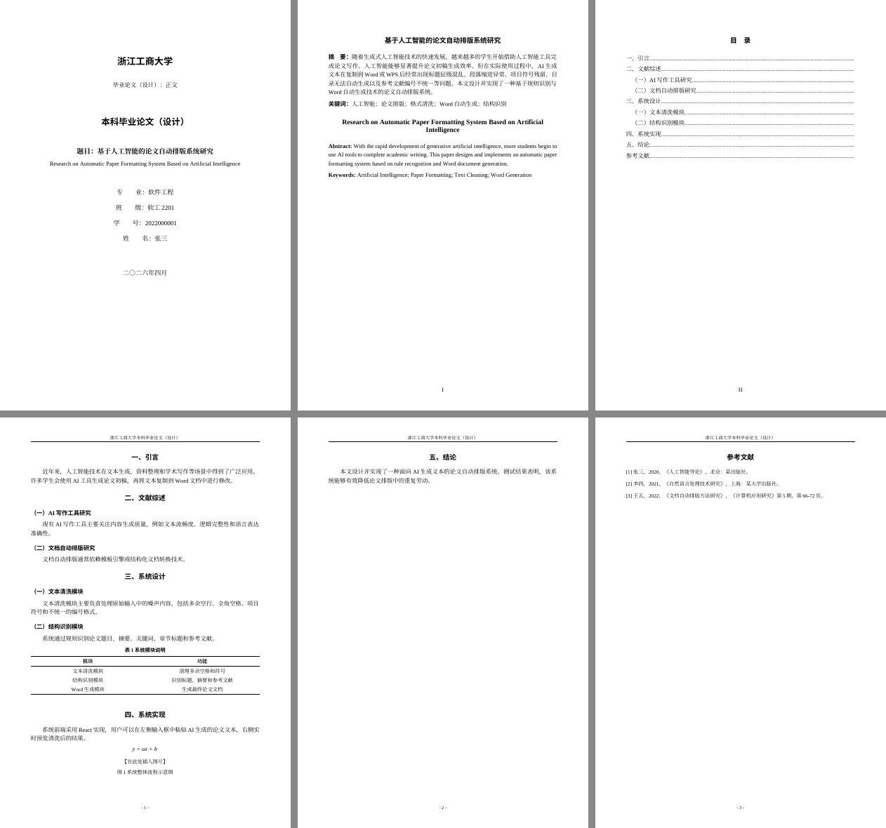

# AI 论文格式清洗器 · Paper Format Cleaner

把 AI 生成的论文文本，一键整理成能直接提交的毕业论文 Word：封面、中英文摘要、自动目录、分节页码、页眉、三线表和规范的参考文献编号。

**在线使用：** https://a0930928334-jpg.github.io/paper-format-cleaner/

所有处理都在浏览器本地完成，论文内容不会上传到任何服务器，也不调用 AI 接口。



## 解决什么问题

从 ChatGPT、Claude、Kimi 等工具复制出来的论文粘进 Word 后，常见问题是：标题层级乱、Markdown 符号残留、目录要手动做、页码和页眉要一节节设置、表格是 `| 竖线 |` 文本、参考文献编号不统一。毕业季这些工作要反复做很多遍。

这个工具把文本当成"有结构的数据"来处理：先识别结构，再按学校格式生成 Word，而不是在 Word 里一处处手改。

## 功能

- **结构识别**：封面信息、摘要 / Abstract、关键词、三级标题、表题、图题、公式、Markdown 表格、参考文献、致谢、附录
  - 标题写法：`一、`、`第一章`、`（一）`、`1.1`、`1.1.1`、Markdown `#` / `##` / `###`（标题里有编号时按编号定级别），以及按连续编号校验的 `1 引言`、`2 Related Work` 和 `Chapter 1 Introduction`
  - 特殊章节兼容 `## 摘要`、`**摘要**`、`【摘要】`、`摘 要：`、`ABSTRACT`、`References`、`Bibliography`、`Acknowledgements`、`附录A 调查问卷` 等写法
  - 行内写法：`摘要：本文……`、`Abstract: This paper …`、`**关键词：**…`、`Key words: …`
  - 清理行内 Markdown：加粗、斜体、行内代码、删除线、链接、图片、引用、分隔线、`<br>`（不会误伤 `a*b*c`、`snake_case` 这类写法）
  - 识别偏保守：拿不准的行保持为正文，例如「[1]指出……」「图1展示了……」「关键词提取是……」都按正文处理
- **输入兜底**：看起来像论文（至少两类论文信号，或两个以上章节标题）但缺题目、摘要或关键词时自动补占位
- **上传文件**：.docx 保留 Word 里的标题样式、列表和表格；PDF 按行提取，合并硬换行，删除页码和每页重复的页眉页脚
- **规范的 Word 输出**
  - 标题使用 Word 内置「标题 1/2/3」样式，导航窗格可用
  - 真正的目录域，页码由 Word 自动计算
  - 分节页码：摘要和目录用罗马数字，正文从阿拉伯数字 1 开始
  - 页眉、页码放在页眉页脚里，而不是写成正文段落
  - 中文用宋体 / 黑体，英文和数字自动用 Times New Roman
  - 表格输出为三线表
  - 两种标题编号：`一、（一）1.`（文科常用）或 `1 / 1.1 / 1.1.1`（理工科常用）
  - 列表保留序号并统一成 `（1）`（文科编号）或 `(1)`（理工科编号）；小数、年份开头的正文原样保留
  - 参考文献、致谢、附录按原文顺序放在正文后面，各自另起一页，进目录但不编号
- **学校模板识别**：上传学校发的格式要求（Word / PDF），自动提取正文和标题的字体、字号、行距、首行缩进
- **普通文档模式**：不是论文的内容（如求职信、报告）按干净的文档格式导出，同样清理 Markdown，`#` 标题用标题样式，表格输出为三线表
- **导出前检查**：提示缺少的摘要、关键词、参考文献，以及正文引用 `[n]` 和参考文献编号对不上的地方
- **本地数据**：文本和设置只保存在本浏览器，页面底部可以一键清除

## 导出效果



> 截图用 LibreOffice 渲染。目录页码在 Word / WPS 中打开时自动生成：如果弹出“是否更新域”，选择“是”；或者右键目录选择“更新域”。

## 工作原理

```
原始文本
  │  applyInputFallbacks   缺题目 / 摘要 / 关键词时补占位
  ▼
  │  normalizeText         逐行规则识别，输出带标签的中间文本
  ▼                        [META] [ABSTRACT] [H1] [H2] [TABLE] [REF] …
中间文本 ──────────────┬─────────────► toHtml        网页预览
  │                    └─────────────► extractStructure 识别结果列表
  │  parsePaper            拆成摘要、正文块、参考文献，生成标题编号
  ▼
  │  buildPaperDocument    docx 生成：封面 / 前置部分 / 正文 三个分节
  ▼
.docx
```

中间文本这一层是关键：识别规则和排版输出完全解耦，加新的学校模板只需要改输出部分，加新的识别规则也不会影响 Word 生成。

## 技术栈

React 19 · Vite · [docx](https://docx.js.org/) 生成 Word · mammoth 读取 .docx · pdf.js 读取 PDF · file-saver 下载

Word、PDF 相关的库都在用到时才按需加载，首屏只需加载约 70KB（gzip）。

## 本地开发

需要 Node.js 20 或更新版本。

```bash
npm install
npm run dev       # 本地开发
npm test          # 单元测试（node:test，70 个用例）
npm run lint
npm run build     # 输出到 dist/
```

推送到 `main` 后，GitHub Actions 会自动运行检查、测试并部署到 GitHub Pages（仓库设置 → Pages → Source 选择 “GitHub Actions”）。

## 项目结构

```
src/
  App.jsx                界面
  sample.js              演示文本
  utils/
    cleaner.js           规则识别：原始文本 → 中间标签文本，以及网页预览
    fileText.js          上传文件转文本：PDF 拼行和重排，.docx 的 HTML 转文本
    paper.js             封面信息、输入兜底、导出前检查等纯函数
    storage.js           本地存储的键和一键清除
    templateRules.js     从学校格式要求里识别字体、字号、行距
    wordExport.js        中间文本 → Word 文档
tests/                   单元测试，覆盖识别、文件转换、模板解析、Word 结构和端到端流程
```

核心逻辑都是不依赖浏览器的纯函数，测试直接在 Node 里跑，并解压生成的 .docx 检查标题样式、目录域、页眉和页码。`tests/e2e.test.js` 用一份混合了 Markdown 标题、行内摘要、正文引用、列表、致谢和附录的「综合 AI 输出」走完整流水线。

中间标签一览：`[META]` `[ABSTRACT]` `[ABSTRACT_EN]` `[KEYWORDS]` `[KEYWORDS_EN]` `[H1]` `[H2]` `[H3]` `[TABLE_CAPTION]` `[FIGURE_CAPTION]` `[TABLE]` `[FORMULA]` `[REFERENCES]` `[REF]` `[ACKNOWLEDGEMENTS]` `[APPENDIX]`。新增标签时要同时更新 `extractStructure`、`toHtml`、`parsePaper` 和 `bodyBlocks`。

## 已知限制和计划

- 图片不会自动插入，导出后在「在此处插入图片」的位置手动插入
- 公式按文本输出，暂不支持 LaTeX 转 Word 公式
- 封面按浙江工商大学格式设计，其他学校会使用通用封面
- 模板识别基于关键词，复杂的格式要求请在「格式设置」里核对
- 识别规则偏保守，漏判时请在原文里补上标题编号（如 `一、`、`1.1`）：
  - `1 引言` 这种写法要求编号从 1 开始连续，跳号或以量词开头（`3 个模块……`）的行按正文处理
  - `（1）xxx` 短行仍按二级标题识别；带句号的长句才按正文处理
  - 英文图表题（`Figure 1.`、`Table 2:`）暂不识别为题注
- PDF：扫描版需要先做文字识别；双栏排版、表格在 PDF 里会被拆成多行；没有句末标点又被折行的参考文献条目可能合并
- .docx：Word 的自动编号（标题前的「第一章」「1.1」由编号样式生成时）不会出现在文本里，标题按 Word 的标题级别识别
- 普通文档模式按 Markdown 规则清理 `__x__`，代码里的 `__init__` 这类写法会被去掉下划线

计划：更多学校的封面模板、LaTeX 公式转换、图片占位自动编号。

## License

MIT
